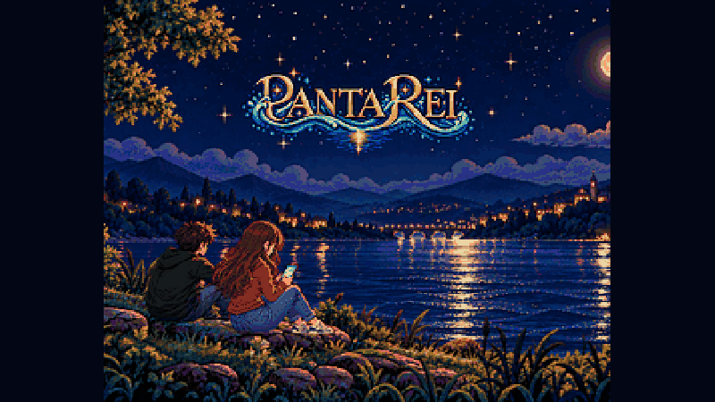

# Panta Rei

*A short, atmospheric narrative game about a river, the sea, and the things that cannot be undone.*

**Panta Rei** (πάντα ῥεῖ, “everything flows”) is a 2D, pixel-art narrative experience made with **Python and Pygame**. Across twelve connected scenes, the story follows Marco and Stella through quiet moments, shifting perspectives, and small interactions that become irreversible choices.

The game is designed around the idea that **interaction can carry meaning**: looking, tracing, moving closer, and letting go are part of the storytelling.

> **Status:** A playable project under active refinement. Built for desktop, with an Android configuration included.

**Play Panta Rei on itch.io:** [opocaj.itch.io/panta-rei](https://opocaj.itch.io/panta-rei)



*Scenes from Panta Rei. The preview cycles through six screenshots.*

## Features

- **12 authored scenes** blending dialogue, animation, and interactive storytelling.
- **Perspective-driven interactions**, including looking around, following the river, and tracing a boundary.
- **Pixel-art presentation** with scene-specific animation, camera movement, and fades.
- **English and Italian** dialogue, selected automatically from the system locale (English fallback).
- **Context-sensitive hints** that appear when the player needs guidance.
- **Desktop and touch-oriented** controls.
- **Replayable experience:** after the credits, the game returns to its opening menu for a fresh playthrough.

## Getting started

### Desktop (Python)

You will need **Python 3.10+** and the complete game assets.

```bash
git clone https://github.com/<YOUR-USERNAME>/<YOUR-REPOSITORY>.git
cd <YOUR-REPOSITORY>
python -m pip install -r requirements.txt
python main.py
```

The Python dependency is Pygame 2.6.x (`pygame>=2.6.0,<3`).

**Assets are required.** The repository includes the `assets/` directory containing the artwork, fonts, and audio needed to run the game.

### Android

The repository includes a `buildozer.spec` for Android packaging. Building an APK requires a compatible Buildozer/python-for-android environment and Pygame recipe; it is not the same as running the desktop Python command. Review the package identifier and Android configuration before distribution.

## How to play

Start from the opening menu with **Start Game**, or choose **Show Commands** for localized instructions. The game introduces interactions contextually as the story progresses.

On desktop, press **Enter** or **Space** to reveal a typing dialogue line or advance after it finishes. Other controls depend on the current scene. Touch-specific instructions are provided on supported mobile builds.

There are no conventional scores or levels: the focus is on exploring a short, linear narrative.

## Language

The game uses the system locale: Italian locales select Italian, and other locales default to English. Dialogue text is stored in:

- `data/dialogue/it/`
- `data/dialogue/en/`

Scene-specific touch instructions are included where needed.

## Project structure

```text
main.py                 # Desktop entry point
game/
  core/                 # Game loop, input, dialogue, audio, transitions, localization
  scenes/               # The twelve narrative scenes and their state machines
  systems/              # Reusable interaction mechanics
  rendering/            # Drawing and presentation
data/
  scenes/               # Scene parameters and timing
  dialogue/{en,it}/     # Localized text
  worlds/               # Shared authored world geometry
  audio/                # Audio configuration
assets/                 # Art, animation, fonts, and sound (required at runtime)
tests/                  # Structural and regression tests
buildozer.spec          # Android build configuration
```

The guiding design principle is:

> **JSON says what; Python says how; assets say what it looks and sounds like.**

Scene logic remains explicit rather than forcing every narrative moment into a generic scripting framework. Rendering and shared systems are reused where they make sense.

## Development and tests

Install dependencies, then run:

```bash
python -m unittest discover -s tests -v
```

The test suite covers structural and regression checks, including localization consistency, scene configuration, shared world data, and important interaction behavior. Passing tests does not replace interactive testing on desktop and Android.

Configuration changes are usually made in `data/scenes/`, while dialogue edits belong in `data/dialogue/`.

## Credits

- **Story, game design, and creative direction:** Jacopo Castellini
- **Pixel art and animation:** AI-assisted, directed by Jacopo Castellini
- **Programming and technical development:** Jacopo Castellini, with ChatGPT
- **Music and sound design:** AI-assisted, directed by Jacopo Castellini

The project includes AI-assisted creative and development work. Any third-party components or assets should be credited separately with their applicable licenses.

## License and reuse

**Source code:** MIT License — see [LICENSE](LICENSE).

**Story, dialogue, artwork, animation, music, sound, and other creative assets:** **not covered by the MIT License**. See [ASSETS_LICENSE.md](ASSETS_LICENSE.md). They are not automatically available for reuse merely because the repository is public.

This separation is intentional: the code can be studied and reused under MIT, while the narrative and artistic identity of *Panta Rei* remains protected. If you would prefer the assets to be openly reusable too, choose and document an appropriate separate license before publishing.

## Feedback and contributions

Bug reports and constructive feedback are welcome through GitHub Issues. If you would like to contribute code, please open an issue first to discuss the proposed change; the game's narrative direction is intentionally authored.

---

*Everything flows.*
